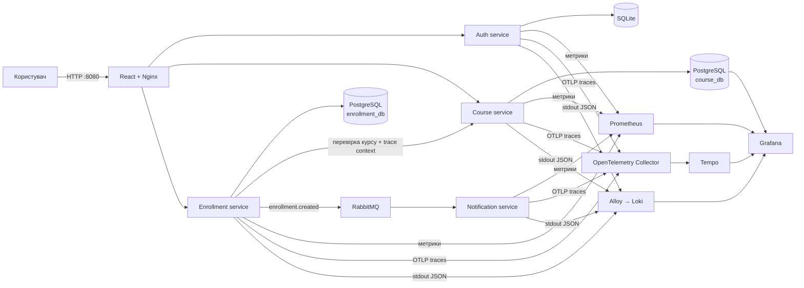

# CourseFlow — LMS microservices skeleton

Навчальний skeleton інформаційної системи LMS на FastAPI. Проєкт показує
авторизацію, окремі бази даних, синхронну й асинхронну взаємодію мікросервісів,
метрики, централізовані логи та розподілені трейси.

## Архітектура



### Мікросервіси

| Сервіс | Призначення | Сховище | Порт |
|---|---|---|---:|
| `auth-service` | реєстрація, login, JWT, ролі | SQLite | 8001 |
| `course-service` | список курсів та admin CRUD | PostgreSQL | 8002 |
| `enrollment-service` | записи на курс і прогрес | PostgreSQL | 8003 |
| `notification-service` | споживання RabbitMQ-подій | — | 8004 |
| `frontend` | React UI та reverse proxy | — | 8080 |

Кожен API-сервіс має `/health`, `/ready`, `/metrics` та OpenAPI-документацію
`/docs`.

## Швидкий запуск

Потрібні Docker Desktop і Docker Compose.

```powershell
Copy-Item .env.example .env
# Перед не локальним використанням змініть JWT_SECRET та паролі у .env
docker compose up --build -d
docker compose ps
```

Перший запуск довший, бо Docker завантажує базові образи та Python/Node
залежності. Після того як усі healthcheck-и стануть `healthy`, відкрийте:

| Інтерфейс | URL | Облікові дані |
|---|---|---|
| LMS | <http://localhost:8080> | `admin` / `admin12345` |
| Grafana | <http://localhost:3000> | `admin` / `admin` |
| RabbitMQ Management | <http://localhost:15672> | `lms` / `lms_password` |
| Prometheus | <http://localhost:9090> | — |

Прямі OpenAPI-сторінки:

- Auth: <http://localhost:8001/docs>
- Courses: <http://localhost:8002/docs>
- Enrollments: <http://localhost:8003/docs>
- Notifications: <http://localhost:8004/docs>

Усі наведені паролі призначені лише для локальної демонстрації та
перевизначаються через `.env`.

## Демонстраційний сценарій

1. Увійдіть у LMS як `admin` або зареєструйте нового студента.
2. Перегляньте курси, отримані `course-service` із PostgreSQL.
3. Натисніть **Записатися** на будь-якому курсі.
4. `enrollment-service` перевірить курс HTTP-запитом до `course-service`,
   збереже запис і опублікує `enrollment.created` у RabbitMQ.
5. `notification-service` отримає подію та запише симуляцію повідомлення в лог.
6. Відкрийте Grafana → **Dashboards → LMS → LMS Overview**.

Той самий flow можна автоматично згенерувати скриптом:

```powershell
./scripts/demo.ps1
```

## Що показує Grafana

Автоматично підключені чотири джерела даних:

- **Prometheus** — request rate, p95 latency, HTTP 5xx та лічильники подій;
- **Loki** — JSON-логи всіх контейнерів, які збирає Grafana Alloy;
- **Tempo** — повний trace від Nginx-запиту через два FastAPI-сервіси до
  RabbitMQ consumer;
- **Course database** — таблиця всіх курсів безпосередньо з PostgreSQL.

Після запису на курс у Tempo можна знайти trace за сервісом
`enrollment-service`. JSON-логи містять `trace_id`, а Loki datasource має
derived field для переходу від логу до відповідного trace.

## Основні API

### Auth

| Метод | Endpoint | Доступ |
|---|---|---|
| POST | `/api/v1/auth/register` | публічний |
| POST | `/api/v1/auth/login` | публічний |
| GET | `/api/v1/auth/me` | Bearer JWT |

Реєстрація завжди створює роль `student`. Dev-адміністратор створюється з
налаштувань `ADMIN_USERNAME` і `ADMIN_PASSWORD`.

### Courses

| Метод | Endpoint | Доступ |
|---|---|---|
| GET | `/api/v1/courses` | авторизований користувач |
| GET | `/api/v1/courses/{id}` | авторизований користувач |
| POST | `/api/v1/courses` | `admin` |
| PATCH | `/api/v1/courses/{id}` | `admin` |
| DELETE | `/api/v1/courses/{id}` | `admin` |

При першому запуску Python-код створює чотири демонстраційні курси. Подальші
оновлення виконуються через CRUD API та одразу відображаються у UI і таблиці
Grafana.

### Enrollments

| Метод | Endpoint | Доступ |
|---|---|---|
| GET | `/api/v1/enrollments` | власні записи користувача |
| POST | `/api/v1/enrollments` | запис на курс |
| PATCH | `/api/v1/enrollments/{id}/progress` | оновлення власного прогресу |

## Відповідність вимогам

| Вимога | Реалізація |
|---|---|
| СУБД у Docker | PostgreSQL для courses/enrollments, SQLite для auth |
| Програмне оновлення даних | Python seed + захищений CRUD курсів |
| Збір метрик | Prometheus scrape `/metrics` кожні 5 секунд |
| Time Series Storage | вбудоване сховище Prometheus з retention 24 години |
| Відображення даних | React LMS та PostgreSQL table panel у Grafana |
| Логи | JSON stdout → Grafana Alloy → Loki |
| Трейси | OpenTelemetry SDK → Collector → Tempo |
| Авторизація | окремий FastAPI-сервіс, SQLite, JWT, ролі |
| Контейнеризація | Dockerfile кожного сервісу + Docker Compose |
| Обмін повідомленнями | RabbitMQ topic exchange і durable queue |

## Корисні команди

```powershell
# Статус контейнерів
docker compose ps

# Логи застосунків
docker compose logs -f auth-service course-service enrollment-service notification-service

# Перевірка всього демонстраційного flow
./scripts/smoke-test.ps1

# Зупинка без видалення даних
docker compose down
```

Повне очищення локальних даних (необоротно для Docker volumes цього проєкту):

```powershell
docker compose down -v
```

## Структура

```text
.
├── docker-compose.yml
├── requirements.txt
├── frontend/                  # React + Nginx
├── services/
│   ├── auth-service/
│   ├── course-service/
│   ├── enrollment-service/
│   └── notification-service/
├── shared/                    # JWT, metrics, tracing, RabbitMQ helpers
├── observability/
│   ├── prometheus/
│   ├── loki/
│   ├── tempo/
│   ├── otel-collector/
│   ├── alloy/
│   └── grafana/
└── scripts/
```

## Межі skeleton-реалізації

- JWT використовує спільний HMAC secret. Для production варто перейти на
  асиметричні ключі та JWKS або зовнішній identity provider.
- Схеми таблиць створюються при старті сервісів. Наступний production-крок —
  додати версійовані Alembic migrations.
- Подія публікується після DB commit. Для гарантованої доставки в production
  потрібен transactional outbox та retry/dead-letter queue.
- TLS, rate limiting, secret manager, backup і Kubernetes навмисно не входять
  до навчального skeleton.

