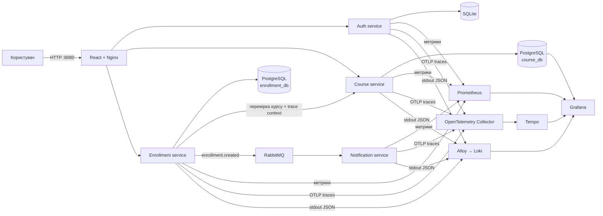

# CourseFlow — навчальна LMS на мікросервісах

## Про проєкт

Це скелет інформаційної системи класу LMS
(*Learning Management System*, система керування навчанням). Зі сторони
користувача це невеликий вебзастосунок для роботи з онлайн-курсами: студент може
зареєструватися, увійти до свого облікового запису, переглянути каталог,
записатися на курс і змінювати свій прогрес. Адміністратор додатково керує
курсами через візуальний інтерфейс.

## Основні можливості

### Студент

- реєстрація нового облікового запису та вхід у систему;
- перегляд опублікованих курсів;
- запис на вибраний курс;
- перегляд власних записів;
- оновлення прогресу проходження курсу;
- вихід з облікового запису.

### Адміністратор

- усі можливості студента;
- перегляд опублікованих і прихованих курсів;
- створення та редагування курсів;
- приховування і повторна публікація курсів;
- видалення курсів.

### Технічна демонстрація

- перегляд стану й API кожного сервісу;
- перевірка даних у PostgreSQL та SQLite;
- перегляд метрик у Prometheus і на готовому дашборді Grafana;
- пошук JSON-логів у Loki;
- перегляд повного шляху запиту в Tempo;
- перевірка черг і повідомлень у RabbitMQ Management;
- автоматичний запуск демонстраційних сценаріїв PowerShell-скриптами.

## Використані інструменти та фреймворки

### Backend

| Інструмент | Для чого використовується |
| ---------- | ------------------------- |
| **Python 3.13** | основна мова всіх backend-мікросервісів |
| **FastAPI** | REST API, обробка HTTP-запитів і генерація OpenAPI-документації |
| **Uvicorn** | ASGI-сервер для запуску FastAPI-застосунків |
| **Pydantic та pydantic-settings** | перевірка моделей запитів і відповідей, читання налаштувань |
| **SQLAlchemy AsyncIO** | асинхронна робота з моделями та базами даних |
| **asyncpg** | асинхронний драйвер PostgreSQL |
| **aiosqlite** | асинхронний драйвер SQLite для сервісу авторизації |
| **HTTPX** | HTTP-виклики між `enrollment-service` і `course-service` |
| **PyJWT** | створення та перевірка JWT access token |
| **pwdlib + Argon2** | безпечне хешування паролів користувачів |
| **aio-pika** | асинхронна публікація та отримання повідомлень RabbitMQ |
| **prometheus-client** | формування метрик на endpoint `/metrics` |
| **OpenTelemetry API/SDK** | створення та передавання розподілених трейсів |
| **OpenTelemetry FastAPI/HTTPX instrumentation** | автоматичне трасування вхідних і міжсервісних HTTP-запитів |
| **pytest та pytest-asyncio** | автоматизоване тестування Python-коду |

### Frontend

| Інструмент | Для чого використовується |
| ---------- | ------------------------- |
| **JavaScript та JSX** | логіка і компоненти вебінтерфейсу |
| **React 19 і React DOM** | побудова інтерфейсу студента й адміністратора |
| **Vite 7** | локальна розробка та production-збірка frontend |
| **React plugin for Vite** | обробка JSX і React Fast Refresh під час розробки |
| **CSS** | адаптивне оформлення сторінок і компонентів |
| **Node.js 24 та npm** | встановлення залежностей і збірка React-застосунку в Docker |
| **Nginx 1.29** | роздавання готового frontend і reverse proxy до API-сервісів |

### Дані та обмін повідомленнями

| Інструмент | Для чого використовується |
| ---------- | ------------------------- |
| **PostgreSQL 17** | окремі бази курсів і записів на курси |
| **SQLite** | локальна база користувачів сервісу авторизації |
| **RabbitMQ 4.1** | асинхронна подія `enrollment.created` і durable-черга повідомлень |
| **REST, JSON та Swagger UI** | формат взаємодії, опис і ручна перевірка API |

### Моніторинг, логи та трейси

| Інструмент | Для чого використовується |
| ---------- | ------------------------- |
| **Prometheus 3.5** | регулярний збір метрик і їх збереження у time series storage |
| **Grafana 12.1** | єдиний інтерфейс для дашбордів, метрик, логів, трейсів і даних курсів |
| **Grafana Loki 3.5** | централізоване збереження та пошук JSON-логів контейнерів |
| **Grafana Tempo 2.8** | збереження й перегляд розподілених трейсів |
| **OpenTelemetry Collector 0.136** | приймання OTLP-трейсів від сервісів і передавання їх у Tempo |
| **Grafana Alloy 1.10** | збирання логів Docker-контейнерів і надсилання їх у Loki |

### Інфраструктура та допоміжні засоби

| Інструмент | Для чого використовується |
| ---------- | ------------------------- |
| **Docker** | ізольований контейнер для кожного компонента системи |
| **Docker Compose** | спільний запуск сервісів, баз даних і observability-стеку |
| **Docker volumes** | збереження даних після перезапуску контейнерів |
| **Docker healthchecks** | контроль готовності сервісів і правильного порядку запуску |
| **PowerShell** | сценарії запуску, smoke-тесту й автоматизованої демонстрації |
| **Git** | контроль версій проєкту |
| **Mermaid** | схема архітектури безпосередньо в README |

## Архітектура



### Мікросервіси

| Сервіс                 | Призначення                  | Сховище    | Порт |
| ---------------------- | ---------------------------- | ---------- | ---: |
| `auth-service`         | реєстрація, login, JWT, ролі | SQLite     | 8001 |
| `course-service`       | список курсів та admin CRUD  | PostgreSQL | 8002 |
| `enrollment-service`   | записи на курс і прогрес     | PostgreSQL | 8003 |
| `notification-service` | споживання RabbitMQ-подій    | —          | 8004 |
| `frontend`             | React UI та reverse proxy    | —          | 8080 |

Кожен API-сервіс має `/health`, `/ready`, `/metrics` та документацію
`/docs`.

## Швидкий запуск

Потрібні Docker Desktop і Docker Compose.

```powershell
Copy-Item .env.example .env
# Перед не локальним використанням змініть JWT_SECRET та паролі у .env
docker compose up --build -d
docker compose ps
```

Перший запуск довший, бо Docker завантажує базові образи та Python/Node
залежності. Після того як усі healthcheck-и стануть `healthy`, відкрийте:

| Інтерфейс           | URL                      | Облікові дані          |
| ------------------- | ------------------------ | ---------------------- |
| LMS                 | <http://localhost:8080>  | `admin` / `admin12345` |
| Grafana             | <http://localhost:3000>  | `admin` / `admin`      |
| RabbitMQ Management | <http://localhost:15672> | `lms` / `lms_password` |
| Prometheus          | <http://localhost:9090>  | —                      |

Прямі OpenAPI-сторінки:

- Auth: <http://localhost:8001/docs>
- Courses: <http://localhost:8002/docs>
- Enrollments: <http://localhost:8003/docs>
- Notifications: <http://localhost:8004/docs>

Усі наведені паролі призначені лише для локальної демонстрації та
перевизначаються через `.env`.

## Демонстраційний сценарій

1. Увійдіть у LMS як `admin` або зареєструйте нового студента.
2. Перегляньте курси, отримані `course-service` із PostgreSQL.
3. Натисніть **Записатися** на будь-якому курсі.
4. `enrollment-service` перевірить курс HTTP-запитом до `course-service`,
   збереже запис і опублікує `enrollment.created` у RabbitMQ.
5. `notification-service` отримає подію та запише симуляцію повідомлення в лог.
6. Відкрийте Grafana → **Dashboards → LMS → LMS Overview**.

Той самий flow можна автоматично згенерувати скриптом:

```powershell
./scripts/demo.ps1
```

## Автоматизована демонстрація окремих можливостей

Скрипт `scripts/showcase.ps1` запускає незалежні демонстраційні сценарії та
показує результат кожної перевірки як `PASS` або `FAIL`:

```powershell
Set-ExecutionPolicy -Scope Process Bypass
./scripts/showcase.ps1 -Scenario databases
./scripts/showcase.ps1 -Scenario crud
./scripts/showcase.ps1 -Scenario auth
./scripts/showcase.ps1 -Scenario metrics
./scripts/showcase.ps1 -Scenario logs
./scripts/showcase.ps1 -Scenario traces
./scripts/showcase.ps1 -Scenario rabbitmq
./scripts/showcase.ps1 -Scenario all
```

```powershell
./scripts/showcase.ps1 -Scenario all -Interactive -OpenBrowser
```

Сценарій баз даних перевіряє PostgreSQL, SQLite і збереження даних після
перезапуску. `crud` створює, оновлює та видаляє тимчасовий курс. `auth`
перевіряє JWT, ролі, відповіді 401 і 403. `metrics` перевіряє scrape targets і
збереження TSDB після перезапуску Prometheus. Інші сценарії підтверджують
доставку логів у Loki, повний trace у Tempo та durable-чергу RabbitMQ.

## Що показує Grafana

Автоматично підключені чотири джерела даних:

- **Prometheus** — request rate, p95 latency, HTTP 5xx та лічильники подій;
- **Loki** — JSON-логи всіх контейнерів, які збирає Grafana Alloy;
- **Tempo** — повний trace від Nginx-запиту через два FastAPI-сервіси до
  RabbitMQ consumer;
- **Course database** — таблиця всіх курсів безпосередньо з PostgreSQL.

Після запису на курс у Tempo можна знайти trace за сервісом
`enrollment-service`. JSON-логи містять `trace_id`, а Loki datasource має
derived field для переходу від логу до відповідного trace.

## Основні API

### Auth

| Метод | Endpoint                | Доступ     |
| ----- | ----------------------- | ---------- |
| POST  | `/api/v1/auth/register` | публічний  |
| POST  | `/api/v1/auth/login`    | публічний  |
| GET   | `/api/v1/auth/me`       | Bearer JWT |

Реєстрація завжди створює роль `student`. Dev-адміністратор створюється з
налаштувань `ADMIN_USERNAME` і `ADMIN_PASSWORD`.

### Courses

| Метод  | Endpoint               | Доступ                   |
| ------ | ---------------------- | ------------------------ |
| GET    | `/api/v1/courses`      | авторизований користувач |
| GET    | `/api/v1/courses/{id}` | авторизований користувач |
| POST   | `/api/v1/courses`      | `admin`                  |
| PATCH  | `/api/v1/courses/{id}` | `admin`                  |
| DELETE | `/api/v1/courses/{id}` | `admin`                  |

При першому запуску Python-код створює чотири демонстраційні курси. Подальші
оновлення виконуються через CRUD API та одразу відображаються у UI і таблиці
Grafana.

Після входу з роллю `admin` у вебінтерфейсі з'являється секція **Керування
каталогом**. У ній можна створювати й редагувати курси, приховувати їх від
студентів, повторно публікувати та видаляти. Адміністратор бачить як
опубліковані, так і приховані курси; студенти бачать лише опубліковані.

### Enrollments

| Метод | Endpoint                            | Доступ                      |
| ----- | ----------------------------------- | --------------------------- |
| GET   | `/api/v1/enrollments`               | власні записи користувача   |
| POST  | `/api/v1/enrollments`               | запис на курс               |
| PATCH | `/api/v1/enrollments/{id}/progress` | оновлення власного прогресу |

## Відповідність вимогам

| Вимога                    | Реалізація                                          |
| ------------------------- | --------------------------------------------------- |
| СУБД у Docker             | PostgreSQL для courses/enrollments, SQLite для auth |
| Програмне оновлення даних | Python seed + захищений CRUD курсів                 |
| Збір метрик               | Prometheus scrape `/metrics` кожні 5 секунд         |
| Time Series Storage       | вбудоване сховище Prometheus з retention 24 години  |
| Відображення даних        | React LMS та PostgreSQL table panel у Grafana       |
| Логи                      | JSON stdout → Grafana Alloy → Loki                  |
| Трейси                    | OpenTelemetry SDK → Collector → Tempo               |
| Авторизація               | окремий FastAPI-сервіс, SQLite, JWT, ролі           |
| Контейнеризація           | Dockerfile кожного сервісу + Docker Compose         |
| Обмін повідомленнями      | RabbitMQ topic exchange і durable queue             |

## Корисні команди

```powershell
# Логи застосунків
docker compose logs -f auth-service course-service enrollment-service notification-service

# Перевірка всього демонстраційного flow
./scripts/smoke-test.ps1
```

## Структура

```text
.
├── docker-compose.yml
├── requirements.txt
├── frontend/                  # React + Nginx
│   └── src/
│       ├── api/               # HTTP-клієнт і робота з JWT
│       ├── components/        # Окремі елементи інтерфейсу
│       ├── hooks/             # Стан і дії LMS dashboard
│       ├── pages/             # Компоненти рівня сторінки
│       ├── App.jsx            # Вибір між входом і dashboard
│       ├── main.jsx           # Запуск React
│       └── styles.css         # Спільні стилі
├── services/
│   ├── auth-service/
│   ├── course-service/
│   ├── enrollment-service/
│   └── notification-service/
├── shared/                    # JWT, metrics, tracing, RabbitMQ helpers
├── observability/
│   ├── prometheus/
│   ├── loki/
│   ├── tempo/
│   ├── otel-collector/
│   ├── alloy/
│   └── grafana/
└── scripts/
```
